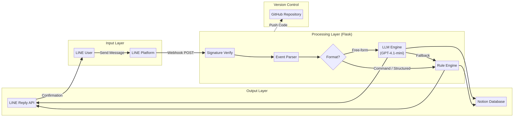

# LINE-Notion-Sync

一個展示 Manus 1.6 Max 跨平台整合能力的自動化工作流專案。透過 LINE 官方帳號接收使用者訊息，經由 **LLM 智慧解析引擎**（GPT-4.1-mini）將自然語言轉換為結構化任務資料，自動寫入 Notion 資料庫，並回傳確認訊息。

## 系統架構



### 雙引擎解析策略

本專案採用 **LLM + Rule Engine** 雙引擎架構，確保智慧與穩定兼顧：

| 引擎 | 觸發條件 | 信心度 | 能力 |
|------|---------|--------|------|
| **LLM Engine** | API Key 已設定且 API 可用 | 95% | 深度自然語言理解、上下文感知、智慧分類 |
| **Rule Engine** | LLM 不可用或回傳錯誤時 | 60-90% | 關鍵字比對、正則表達式解析 |

- **指令格式** 和 **結構化格式**：永遠使用 Rule Engine（格式確定性高）
- **自由輸入格式**：優先使用 LLM Engine，失敗時自動降級至 Rule Engine

### 三層式架構

1. **Input Layer (LINE)**: 使用者透過 LINE 發送訊息，LINE 平台將訊息封裝為 Webhook Event 發送至伺服器。
2. **Processing Layer (Flask + LLM)**: 伺服器接收並驗證請求，透過 LLM API 將非結構化文字轉換為結構化任務資料。
3. **Output Layer (Notion)**: 透過 Notion API 將結構化資料寫入指定的 Notion 資料庫，並透過 LINE 回傳確認訊息。

## 專案結構

```
line-notion-sync/
├── app/
│   ├── __init__.py
│   ├── main.py              # Flask 應用程式與 Webhook 進入點
│   ├── line_handler.py      # LINE Messaging API 處理邏輯
│   ├── llm_parser.py        # LLM 智慧解析引擎（OpenAI API）
│   ├── notion_client.py     # Notion API 整合模組
│   └── data_processor.py    # 雙引擎資料處理與解析邏輯
├── config/
│   ├── __init__.py
│   └── settings.py          # 環境變數設定檔
├── tests/
│   ├── test_processor.py    # 資料處理模組測試
│   └── test_llm_parser.py   # LLM 解析引擎整合測試
├── docs/
│   ├── architecture.mmd     # 架構圖原始檔
│   └── architecture.png     # 架構圖
├── requirements.txt         # 依賴套件
├── .env.example             # 環境變數範例
└── README.md                # 專案說明文件
```

## 前置準備

1. **LINE Official Account**:
   - 前往 [LINE Developers Console](https://developers.line.biz/) 建立一個 Messaging API Channel。
   - 取得 `Channel Secret` 與 `Channel Access Token`。
   - 設定 Webhook URL（例如使用 ngrok：`https://<your-ngrok-url>/webhook`）。

2. **Notion Integration**:
   - 前往 [Notion Developers](https://www.notion.so/my-integrations) 建立一個 Internal Integration。
   - 取得 `Internal Integration Token` (API Key)。
   - 在 Notion 中建立一個資料庫，並將該資料庫分享給剛建立的 Integration。
   - 取得資料庫的 ID（從資料庫網址中提取）。

3. **OpenAI API Key**（可選，但強烈建議）:
   - 前往 [OpenAI Platform](https://platform.openai.com/) 取得 API Key。
   - 若未設定，系統會自動使用 Rule Engine 作為解析引擎。

## 執行環境設定

1. 建立虛擬環境並安裝依賴：
   ```bash
   python -m venv venv
   source venv/bin/activate
   pip install -r requirements.txt
   ```

2. 設定環境變數：
   ```bash
   export LINE_CHANNEL_ACCESS_TOKEN="your_line_token"
   export LINE_CHANNEL_SECRET="your_line_secret"
   export NOTION_API_KEY="your_notion_api_key"
   export NOTION_DATABASE_ID="your_notion_database_id"
   export OPENAI_API_KEY="your_openai_api_key"
   export LLM_MODEL="gpt-4.1-mini"
   ```

3. 啟動伺服器：
   ```bash
   python -m app.main
   ```

## 使用方式

在 LINE 中向您的機器人發送以下格式的訊息：

1. **自由輸入**（由 LLM 智慧解析）：
   `明天下午三點要開會，優先級高`
2. **結構化輸入**：
   `標題: 準備簡報 | 日期: 2026-04-10 | 優先級: 高`
3. **指令輸入**：
   `/task 寄送發票 --priority medium --date 2026-04-06`

系統會自動解析並將任務寫入 Notion 資料庫，同時在 LINE 中回覆確認訊息（包含使用的解析引擎和信心度）。

## 內建指令

| 指令 | 說明 |
|------|------|
| `/help` 或 `幫助` | 顯示使用說明 |
| `/status` 或 `狀態` | 查看系統狀態（含 LLM 引擎狀態） |
